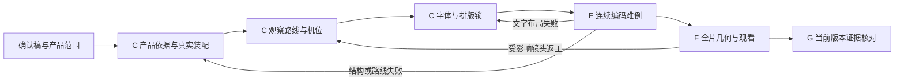

# 把建模、运镜、排版变成准出条件

## 2026-10-21 · 制作方法与证据更新

现有film-plan/visual_contract附入[《奇点》逐镜工作单](singularity-blender-production.md)：主判断、空间方向、景别、动作/停稳、近景需求与交接；材质/光照变化重验受影响范围。自动节点与人工方法的边界见[制作复盘](production-lessons.md)。 核心继续只验证结构/覆盖/SHA，不签发release_ready。

visual-nodes-1，2026-10-11。嵌入现有 A–H Workflow，不建立第二份任务状态。适用于后续新任务；旧任务继续使用原固定规范，已提交媒体、报告和批准不迁移或补签。

工程参考是 Treeloop 作者提出的阶段契约、条件、回流、过程和证据分工：[长任务交付链路](https://blog.51cto.com/aioldsix/14909117)。本次读取到搜索索引中的 Workflow、Condition、Loop、Trace、Evidence、Card 段落，原网页打开超时；未安装其框架、未复制源码或宣称核完全文。以下为本项目实现。

## 节点与失败回流



C 内部三个条件全部满足才准出；它们不是新顶级阶段，不各建状态文件。C 的 `visual_contract` 是版本化产物，`job.json.workflow` 继续唯一保存推进状态。

| 条件 | 实际输入/证据 | 明确失败例 | 回流 |
|---|---|---|---|
| 产品依据与真实装配 | 官网成熟产品原图或可说明的原理资料、实际查看记录、部件采用/不采用特征、同机位模型对照；闭合/开盖/内部近景/最大视角/复位 | 只有方块和表面线条；接口无落点；管路穿壳；无安装/紧固/维护关系；金属和橡胶同质；用发光掩盖结构 | C 结构/材料/构图 |
| 观察路线与机位 | 每镜头观察目的、焦点、移动与停稳理由、前镜头、交接依据和路线证明；E 实际连续样片 | 为动而动的横摆、无新信息环绕、每段重新起步、突然重置部件、穿盖/穿管、移动时说明焦点不可见 | C 路线；渲染故障留 E |
| 字体与排版锁 | 实际字体/profile SHA、每行墨迹、全画面中轴、字号/宽度/上方信息起点、难例证明 | 安全框没越界但字幕偏左/太小；按安全框中心替代画面中心；改大字体吞字/断词；标题贴顶；黑框遮正文 | C 排版；对齐/漏读回 D |
| E 连续编码难例 | 原生工程重开；开场及正文难例；先总览、开盖、靠近、停稳看细节、明确交接；两行字幕、问答、数字、亮暗产品 | 仅静帧、轨迹数值或无声截图；以一镜到底代替功能；旧样片批准冒充新模型批准 | 最早根因 C/D；有限重试 |
| F 当前全片 | 全帧实际字形及焦点；最终编码边界/360与390宽；连续音画、实听与实际 UI 分开 | 数值连续便称丝滑；样片通过便称整片通过；模拟遮罩称实机 | 受影响节点；新版绑定 |

## 相机与产品的共同规则

连贯性来自空间关系和观察目的，不等于强制一镜到底。保持同一产品、同一装配坐标、同一管路/连接方向。先建立整体位置，再让壳体或盖板让开，从原位置靠近所讲部件，停稳让观众读懂，再沿真实功能路径进入下一处。跨维护区域允许说明清楚的匹配切镜；不能穿过实体强行连接。

“人的第一视角”采用站在设备前靠近、俯看、开盖后探近、退让和停稳的观看顺序，不加入模拟头晃、呼吸抖动或往返横摆。插值、速度/加速度和四元数记录可查跳变，但只能作为技术证据；实际丝滑须连续观看。数据、判断、提问和回答允许有目的的停留。开场真实环绕仍按已有契约验，正文不为满足动作数量强加环绕。

参考必须落实成产品特征。液冷示例包括：机架耳板/滑轨/维护面板，成对供回液与安装支撑，冷板接触面/流道/密封边/真实贯通接口，快接锁套/压接套，CDU双泵/四端口隔离换热/过滤/传感线束。只采用有依据的通用功能关系，不把不同型号拼成厂商 CAD，不虚构尺寸、性能或供应关系。原理剖面、检修隔离和运行状态要区分；只在能解释本期内容的尺度增加细节。

## 排版规则与可执行检查

后续1080×1920默认从已接受排版起步：字幕56px，透明背景、最多两行；每行实际墨迹围绕全画面 x=540 独立居中，容差≤2px，最大墨迹宽672px。窄化行宽预留右侧 UI，不把字幕中心挪到左侧安全区。字幕位置继续按锁定 profile；超长句按最终对齐拆页，保留原字幕ID、完整句子、专名、术语、数字与单位。

上方正文信息默认最上墨迹 y≥160；标题、章节、说明、问答和数据作为一个排版系统处理。具体坐标按本期构图锁定，不能把本期相对“下移60px”变成逐期累加。非关键品牌装饰按具名例外核，不能借例外豁免标题/说明。改字号/位置后重新检查上方信息彼此、字幕、卡片与功能实体；间隔仍≥24px。一次性参数改变不授权其他风格变化。

本地完整 checker 对带新字段的 profile 执行：逐行墨迹中心、最大宽度、最小字号、透明背景记录、标题/`region=header`上方信息起点；仍保留全帧 timing、碰撞、功能焦点、编码和设备门。透明背景的像素效果及美术可读性仍须看最终编码，记录值不能代替它。旧 profile 不追写新字段；新任务 C 契约禁止漏填这些字段。

## 准出、恢复与阶段卡

```bash
python3 scripts/workflow.py --job jobs/example card
python3 scripts/workflow.py --job jobs/example accept --step C --report C-design/review.json
python3 scripts/workflow.py --job jobs/example accept --step E --report E-model/review.json
```

`card` 只读现有状态，给当前阶段、固定条件、必需产物、阻断和一次恢复上限；不生成新台账或自行运行供应商。缺 `visual_contract` 不得登记 C；契约不锁定、错绑定、参考/路线证明缺失、镜头未覆盖或装饰横摆标记不得准出。证明文件变更使 C 及后续依赖失效。现有授权和批准在其原版本范围有效，不为填写节点重复索要确认。

E 的固定观察ID：`caption_center_readability/header_hierarchy/caption_word_integrity`；3D另有 `product_realism_states/camera_continuity/camera_motion_purpose`。缺项、pending、无真实感知能力或无当前证据不能 accept。C 三个条件也有固定ID，不只存在于提示词。

最终仍使用原12项报告：产品依据/多姿态进入 model_coverage，目的和交接进入 dynamic_playback，居中/层级/保词进入 layout_geometry，最终排版可读性进入 encoded_masked_review。最小核心拒绝从 spec 删除这些最低观察；它验证结构/SHA，不自动判断产品真实、丝滑或听感，不签发 release_ready。F准出、最终完整 checker、供应商与发布仍按原接入边界执行。

失败用原 badcase/recovery：写预期、实际、最早根因、漏检、最小修复和恢复条件；复测原失败及原成功，保留证明。同类反馈核全期，不能仅修点名镜头。未知保持 pending，规则部署不代表成片或传播效果已验证。


## 2026-10-12：口播与产品标注同步（光模块能力回归）

用户纠正：“视频应该讲到哪里在画面点出产品，标注出来，这个在光模块那期有，估计后面又漏了吧”。保留这一能力作为后续视频必验项，不能只保留章节标题、字幕或公司数据卡。

C设计建立`product-callouts.json`：每个技术解释窗口绑定当前稿件SHA、原句/术语、最终词对齐时点、镜头ID、实际语义节点、可见表面锚点、标签文字/引线和退出条件。公司商业段允许不标部件，需明示理由；软件/协议采用作用流程图，不伪装成实体部件。不得把通用示意画成未经核实的厂商供货或内部版图。

E样片和F全片须在“正在讲”的部件上点出名称：先让部件可见，再在对应口播附近指向；引线落到真实可见表面或接口，镜头移动时从原生矩阵/相机求值跟随。每个标签逐帧记录caption_id/术语、component_id/semantic_nodes、anchor_xy、ink_rect、start/end_frame、可见性、退出原因。转场旧标签及时退出，不跟错产品、不漂浮指向空白；遮挡/出画先改机位或延后标签，不用假框补证。

标签与字幕、标题、卡片实际墨迹保持≥24px；标签和引线留在本期安全区，不挡所解释的接触面、连接或重要器件。不要求所有部件长驻或一次贴满。C核全稿技术段映射完整；E抽查运动近景、细小端口和两行字幕同屏；F核全部解释窗口、出现/退出帧与最终编码360/390宽。遗漏、错指、提前贴到未出现部件、切镜残留或遮挡理解的部件都属阻断，回流C（设计）或D（对齐）。

继续使用原12项报告：model_coverage记录`spoken_product_identification`，layout_geometry记录`callout_anchor_and_gap`，encoded_masked_review记录`callout_phone_readability`，dynamic_playback记录`callout_tracking_and_handoff`。自动覆盖/几何通过不等于表面可见、实际指向或完整播放通过；没有连续观看/听音能力保持pending。规则部署不证明旧片已补标；已提交历史媒体不改动。本期按用户明确要求应用，固定Workflow实现与政策副本保留，不给旧任务补签批准。

2026-10-12工程准出：3D的C新增固定观察`spoken_product_callout_plan`并强制读取SHA绑定标注计划；缺原句/标签/语义节点、错镜头/时间窗或改动旧计划均阻断。C检查者须具备read_script与view_images。E新增`spoken_product_identification`，原12项报告增加标注跟随、锚点间隔、编码手机可读性对应最低观察。机制在单一job.json中运行，不新增第13项报告，也不把synthetic测试当真实影片验收。既有在途任务保持原固定核心；若另用本地完整标注检查器须记录其独立版本与能力，不把它当成本包已分发功能。旧任务与已发布资产不迁移。
